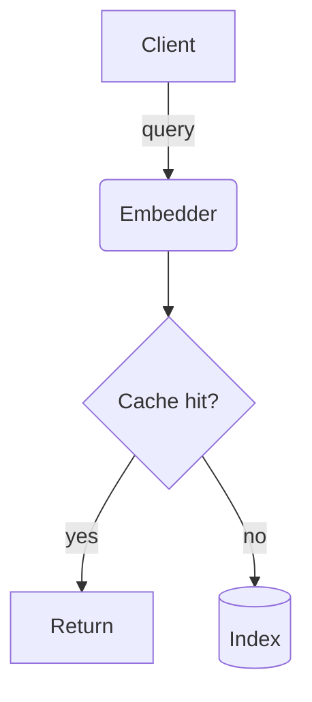

# Diagrams (Mermaid, `libs: mermaid`)

Write the diagram source inside `<pre class="mermaid" role="img" aria-label="...">`. The theme renders it (and re-renders on dark/light switch). On a syntax error the panel shows an error callout, so check the syntax.

## Supported types
`flowchart`, `sequenceDiagram`, `stateDiagram-v2`, `erDiagram`, `gantt`, `timeline`, `mindmap`, `journey`, `quadrantChart`, `gitGraph`. Pie goes to Chart.js (doughnut). Other types are not themed; avoid them.

Download size: a page with a Mermaid diagram is about 5.4 MB because the engine travels inside the file. For a simple flow of a few boxes, the HTML `.stepper`, `.timeline` or a small D3 graphic is a far lighter download; use Mermaid when the structure really is a graph, sequence, state machine or schema.

## Direction
Use **`flowchart TB`** (top to bottom). `LR` shrinks to unreadable text in a side panel. Use `LR` only for a chain of at most four short nodes. The lint warns on `LR`.

## Size limits (the panel is about 400 to 500 px wide)
- Flowchart: at most 12 nodes; node labels 3 words or fewer (put detail in the caption or a following list). If you need more, split into two diagrams or use `subgraph` to group.
- Sequence: at most 5 participants, 12 messages.
- ER: at most 6 entities with 6 attributes each.
- Gantt: at most 12 tasks. The axis defaults to weekly ticks labelled like `04 Oct`. For ranges over about 3 months add `axisFormat %b` and `tickInterval 1month` lines to the diagram; for a few days add `tickInterval 1day`. Overlapping axis labels mean the interval is too small.
- Timeline and journey: they render with small text in a side panel. For up to 8 dated events prefer the plain HTML `.timeline` component (`references/components.md`); use Mermaid timeline only for grouped periods.
- Mindmap: depth 3, at most 20 nodes.
- `<br/>` in a label gives a deliberate line break (it works inside the `<pre>`); use no other HTML tags.

## Colour: token classes only
Append `class NodeId accent|ok|warn|danger|info|muted` lines at the end of a flowchart (or `:::ok` after a node). Do not write `style`, `classDef`, `linkStyle` or `%%{init}%%` lines, and never a hex value (hex is a lint error; the others are warnings). Meaning: `accent` the focus of the diagram, `ok`/`warn`/`danger` status, `info` neutral notice, `muted` optional or external.



## Shapes
`[rect]`, `(rounded)`, `([stadium])`, `[(database)]`, `{decision}`, `((circle))`. Edge labels: `-->|text|`. Dotted edge: `-.->`. Thick: `==>`.

## Subgraphs (architecture)
```
flowchart TB
  subgraph Edge
    CDN --> LB[Load balancer]
  end
  subgraph Core
    API --> DB[(Postgres)]
  end
  LB --> API
```
Keep subgraph titles to one or two words.

## Sequence example
```
sequenceDiagram
  participant U as User
  participant A as API
  U->>A: POST /search
  A-->>U: 200 results
```
Use `->>` for calls and `-->>` for returns. `Note over A: text` sparingly.

## Accessibility and caption
`aria-label` states the reading of the diagram in a sentence or two (what flows where, what is highlighted). The caption names the source (file, config, query) the structure was read from. Structure comes from code you read, not from memory.

## Do not
- Do not write diagrams from assumptions about the code. Open the files first.
- Do not use Mermaid for charts of numbers, for pie, or for anything needing precise positioning.
- Do not use `click` directives or any URL: the lint rejects them.

## Examples
`examples/04-flow.visual.html` (flowchart with token classes), `examples/05-architecture.visual.html` (subgraphs).
